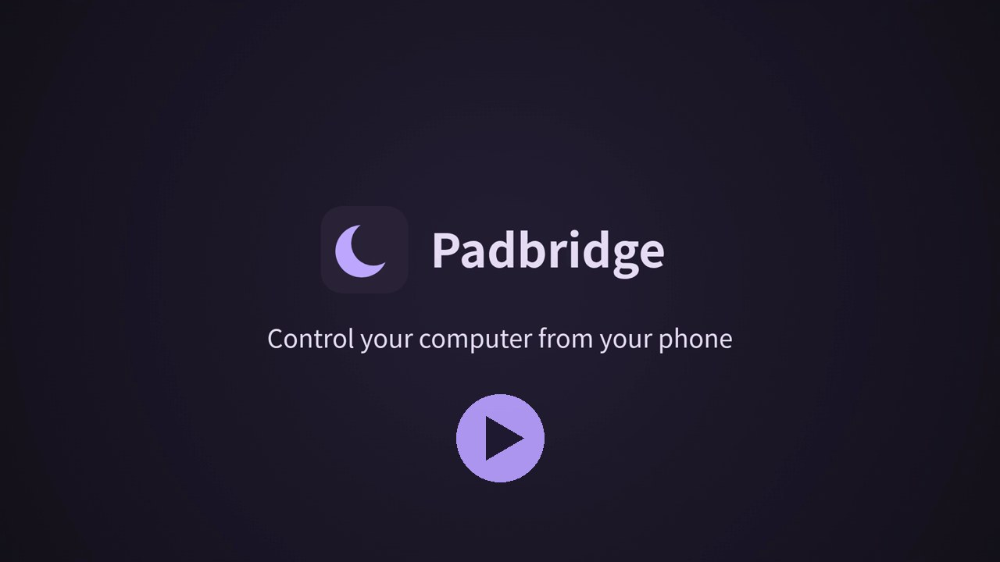

# Padbridge

**把手機變成電腦的輸入中繼站。** ／ **Turn your phone into an input relay for your computer.**

[中文](#中文) · [English](#english)

---

## 中文

### 這是什麼

臨時要用滑鼠卻沒帶？要從沙發遠端操作電腦？好幾個人想輪流控制同一台電腦？
Padbridge 讓 Android 手機變成電腦的觸控板，透過 **Wi-Fi** 控制電腦游標。

滑鼠只是第一步。Padbridge 的目標是當「輸入中繼站」：手機接住藍牙搖桿、鍵盤、滑鼠、手錶手勢，再透過 Wi-Fi 轉給沒有藍牙、或不方便配對的電腦。

[](https://cdn.jsdelivr.net/gh/luna61ouo/padbridge@main/docs/intro-zh.mp4)

▶ 45 秒介紹影片，點圖片播放

### 現在能做什麼

- 電腦只要裝一個 Windows 小程式（右下角圖示）；手機不需要任何特殊權限
- 一支手機可以控多台電腦（App 裡切換），多支手機也可以控同一台電腦（各自配對）
- 跟眼鏡、耳機、手錶等藍牙裝置並存，不搶藍牙
- 觸控板：單指移動、點一下左鍵、雙指點右鍵、雙指上下捲動；拖曳＝點一下後馬上再按住滑（點後拖），或按住不動一下再滑
  - 打字直接在觸控板裡：按 ⌨ 或三指點一下，叫出手機自己的輸入法（注音、拼音都行），選定的字才送出，電腦不用切輸入法；附常用鍵一排，觸控板照樣能用
  - **全螢幕（簡報用）**：整個畫面只剩觸控板，音量下＝下一頁、音量上＝上一頁（跟簡報筆一樣送 PgDn／PgUp），返回鍵離開
- 上方一行看連線狀態與切換電腦，三個模式（觸控板｜繪圖板｜鍵盤）一鍵切換
- **電腦鍵盤**（跟觸控板、繪圖板並列的第三個模組，內容全部加密）：橫放的完整美式鍵盤（含 F1～F12、方向鍵），送的是實體按鍵，快捷鍵、遊戲都能用。組合鍵可以多指按，也可以不用多指：Ctrl／Shift／Alt／Win 點一下＝鎖一次、再點＝一直鎖住；「🔒 鎖」再點任何鍵＝那顆一直按著
  - 按著的鍵每 0.3 秒重送一次，電腦 1 秒沒收到就全部放開，網路斷了也不會卡住 Ctrl
- **自動更新**：手機、電腦、GitHub 三邊比版本，誰舊誰提示，按了才更新；電腦端可以直接由手機更新（不用上網），只裝發布金鑰簽過名、而且比較新的版本
- **繪圖板模式**（絕對座標，配一支觸控筆就是繪圖板）：
  - 畫布＝電腦螢幕，碰哪裡游標就到哪裡；直放（下方有手掌區）或橫放（大畫布）
  - 兩種點擊：「自動左鍵」碰到就按下；「按鍵觸發」碰到只移動（像筆懸空），用畫面按鍵或音量鍵點擊
  - 畫面預覽：電腦畫面加密後傳到手機當畫布背景（約每秒 10 張）
  - 兩指縮放／拖曳＝只對應螢幕的一部分；「調整範圍」＝只用手機畫面的一小塊（節奏遊戲常用）
  - 多螢幕：勾選要顯示哪些螢幕，勾兩個以上就同時排在畫布上、碰哪個到哪個，每個螢幕的觸控範圍可以各自調整
- **Android 被控端（實驗中）**：另一台 Android（例如車機、平板）裝同一支 App、開「Padbridge 被控端」無障礙服務，就會出現在「選電腦」清單裡——觸控板移動畫面上的游標、點一下＝點擊、按住拖曳＝放開後滑過去、捲動＝上下滑、右鍵＝返回、中鍵＝主畫面；繪圖板模式也能用，畫面預覽約每秒 3 張（Android 截圖頻率限制，需要 Android 11 以上）。目前還沒有設定畫面，配對要用 adb：
  `adb shell am broadcast -a io.github.luna61ouo.padbridge.CMD -p io.github.luna61ouo.padbridge --es op rxtoken --es id <控制端名稱> --es token <自訂配對碼>`，控制端用 `--es op wifi --es host <被控端 IP> --ei port 47801 --es token <同一組配對碼>` 加入
- 配對：電腦圖示顯示 QR，手機 App 掃一下就好
- 電腦端圖示：顯示連入的手機（名稱可自訂）與使用狀態，可暫停、可撤銷某支手機、檢查更新

### 安裝

**手機（Android 10 以上）**：到 [Releases](../../releases) 下載 `padbridge-*.apk` 安裝。

**電腦（Windows 10／11）**：
1. 到 [Releases](../../releases) 下載 `PadbridgeSetup-windows-*.zip`，解壓縮
2. 雙擊 `PadbridgeSetup.cmd`
   - 出現「Windows 已保護您的電腦」→ 按「其他資訊」→「仍要執行」（安裝檔沒有付費數位簽章）
   - 問要不要允許變更 → 按「是」（要設定防火牆）
3. 右下角出現 Padbridge 圖示就裝好了，之後每次登入會自己啟動

手機 App 也找得到下載入口：「選電腦」→「電腦還沒裝 Padbridge？」，會顯示上面的 Releases 網址。網址不好打的話，可以讓電腦瀏覽器連到手機的區網 IP，網頁上自己選：
- **快速直接下載**：從手機拿同一個安裝包（不含任何配對碼）。走一般 HTTP，同網路的人有機會把檔案換掉，只在自己信任的網路用。
- **高安全性下載**：轉到 GitHub 發布頁，經 HTTPS 下載；請確認網址列是 `github.com/luna61ouo/padbridge`。

兩邊是同一個檔案，手機畫面會顯示 SHA-256，可以跟 `certutil -hashfile <檔名> SHA256` 對照。

**配對**：電腦圖示按右鍵 →「加一支手機（掃 QR）」→ 手機 App 切到 Wi-Fi →「選電腦」→「掃 QR 加電腦」。

### 安全設計

- 每支手機對每台電腦各有一把配對碼，**配對碼不會在網路上傳**：每個封包附上用配對碼算的簽章（HMAC-SHA256）與流水號，電腦只收簽章正確、流水號遞增的封包，同網路的人無法偽造或重播點擊。
- 配對碼透過「螢幕上的 QR → 手機相機」交給手機，不經過網路。
- 電腦防火牆只開 UDP 47801，只收同一個區網。
- 電腦端圖示可以隨時暫停，或撤銷某支手機。
- 鍵盤內容與畫面預覽一律加密（AES-256，金鑰由配對碼導出）。
- 自動更新只裝用發布金鑰簽過名（RSA-3072）、而且版本比較新的安裝包：GitHub 帳號被盜、下載被調包、或有人拿到配對碼，都推不了假更新，也不能降版。
- 仍會公開的：同網路的人看得到「有人在動滑鼠」（滑鼠移動沒加密）；找電腦時電腦會回覆主機名稱與版本。

### 從原始碼建置

需要 Android SDK（platform 35、build-tools 35.0.0）與 JDK 11 以上，不用 Gradle：

```bash
./build.sh          # 產出 build/padbridge.apk（沒有金鑰時會自動產一把 debug 用的）
./release.sh        # 產出 dist/ 裡的 APK 與 Windows 安裝包
```

自己建置的版本沒有發布金鑰的簽名，電腦端的自動更新不會接受（要用自己的金鑰：設定 `PADBRIDGE_UPDATE_KEY`，並換掉 `windows/PadbridgeUpdate.cs` 裡的公鑰）。

### 目前限制

- 電腦端目前只支援 Windows；App 介面目前是中文
- Android 被控端還不支援鍵盤
- 規劃中：搖桿／手勢轉送、筆壓、低延遲畫面串流
- 0.9.0 的藍牙（BLE）模式已移除：要穩定得靠一個用 adb 權限跑的小幫手，對一般使用者來說要開的權限太大

### 授權

Apache License 2.0，見 [LICENSE](LICENSE)。使用的第三方元件見 [NOTICE](NOTICE)。

---

## English

### What is it

Need a mouse but didn't bring one? Want to control your PC from the couch? Several people taking turns on one computer?
Padbridge turns an Android phone into a touchpad for your computer, over **Wi-Fi**.

The mouse is just the first piece. Padbridge aims to be an **input relay**: the phone receives Bluetooth gamepads, keyboards, mice and watch gestures, and forwards them over Wi-Fi to computers that have no Bluetooth or are inconvenient to pair.

[](https://cdn.jsdelivr.net/gh/luna61ouo/padbridge@main/docs/intro-en.mp4)

▶ 45-second intro video. Click the image to play.

### What works today

- Install one small Windows receiver (tray icon) on the PC; the phone needs no special permissions
- One phone can drive several PCs (switch in the app), and several phones can share one PC (each paired separately)
- Coexists with Bluetooth glasses, headsets and watches — it doesn't use Bluetooth at all
- Touchpad: one-finger move, tap = left click, two-finger tap = right click, two-finger scroll; drag = tap then immediately touch and slide (tap-and-drag), or press and hold, then move
  - Typing lives inside the touchpad: tap ⌨ or tap with three fingers to bring up the phone's own IME (Zhuyin, Pinyin, anything); only committed text is sent, so the PC doesn't need to switch input methods. A row of common keys comes with it, and the touchpad keeps working
  - **Full screen (for presentations)**: nothing but the touchpad; volume down = next slide, volume up = previous slide (PgDn/PgUp, like a presenter clicker); Back exits
- One line at the top shows the connection and switches PCs; the three modes (touchpad | tablet | keyboard) are one tap apart
- **PC keyboard** (a third module next to touchpad and tablet, all content encrypted): a full landscape US layout (F1–F12, arrows) that sends real key presses, so shortcuts and games work. Combos with several fingers, or without multitouch: tap Ctrl/Shift/Alt/Win once = latch for one key, tap again = lock; "🔒 鎖" (lock) then any key = hold that key down
  - Held keys are re-sent every 0.3 s and the PC releases everything after 1 s of silence, so a dropped connection can't leave Ctrl stuck
- **Auto-update**: phone, PC and GitHub compare versions; whichever is older shows a prompt, and nothing installs until you tap it. The phone can update the PC directly (no internet needed); the PC only installs packages signed with the release key and newer than what it has
- **Drawing-tablet mode** (absolute positioning — add a stylus and it's a pen tablet):
  - The canvas is your PC screen: touch a point and the cursor jumps there; portrait (with a palm-rest zone) or landscape (bigger canvas)
  - Two click styles: "auto left button" presses on touch; "button trigger" only moves on touch (like a hovering pen) and clicks with on-screen buttons or the volume keys
  - Screen preview: the PC screen is encrypted and streamed to the phone as the canvas background (~10 fps)
  - Pinch / two-finger drag maps the canvas to part of the screen; "adjust area" uses only part of the phone screen (common for rhythm games)
  - Multiple monitors: tick which monitors to show; with two or more they're laid out together, touch one to use it, and each monitor's area can be moved and resized
- **Android as the controlled device (experimental)**: install the same app on another Android device (a car head unit, a tablet…) and enable the "Padbridge 被控端" accessibility service; it then shows up in the PC list. The touchpad moves an on-screen cursor, tap = tap, press-and-drag = swipe along the path on release, scroll = swipe up/down, right button = Back, middle button = Home. Drawing-tablet mode works too, with a ~3 fps screen preview (Android's screenshot rate limit; needs Android 11+). There is no settings screen yet, so pairing needs adb:
  `adb shell am broadcast -a io.github.luna61ouo.padbridge.CMD -p io.github.luna61ouo.padbridge --es op rxtoken --es id <controller-name> --es token <your-pairing-code>`, then on the controller `--es op wifi --es host <device-IP> --ei port 47801 --es token <same-code>`
- Pairing: the PC tray icon shows a QR code; scan it in the app
- Tray icon: lists connected phones (custom names) and their status, pause, revoke a phone, check for updates

### Install

**Phone (Android 10+)**: download `padbridge-*.apk` from [Releases](../../releases).

**PC (Windows 10/11)**:
1. Download `PadbridgeSetup-windows-*.zip` from [Releases](../../releases) and extract it
2. Double-click `PadbridgeSetup.cmd`
   - "Windows protected your PC" → "More info" → "Run anyway" (the installer is not code-signed)
   - Allow the admin prompt (needed for the firewall rule)
3. The Padbridge tray icon appears; it starts automatically at every logon

The app can point you there too: "選電腦" (choose PC) → "電腦還沒裝 Padbridge？" (PC doesn't have Padbridge yet?) shows the Releases URL. If typing it is a pain, the PC's browser can open the phone's LAN address and choose:
- **Quick download**: the same setup zip served by the phone (it contains no pairing secret). Plain HTTP, so someone on the same network could swap the file — only use it on a network you trust.
- **High-security download**: redirects to the GitHub release page over HTTPS; check the address bar shows `github.com/luna61ouo/padbridge`.

Both are the same file; the phone shows its SHA-256 so you can compare with `certutil -hashfile <file> SHA256`.

**Pairing**: right-click the tray icon → "加一支手機（掃 QR）" (add a phone via QR) → in the app switch to Wi-Fi → "選電腦" (choose PC) → "掃 QR 加電腦" (scan QR).

### Security

- Each phone gets its own pairing key per PC. **The key never travels over the network**: every packet carries an HMAC-SHA256 signature and a strictly increasing counter, so others on the same network cannot forge or replay clicks.
- The key is handed over screen-to-camera via the QR code.
- The PC firewall opens only UDP 47801, local subnet only.
- Pause or revoke any phone from the tray icon.
- Keyboard content and screen previews are always encrypted (AES-256, key derived from the pairing key).
- Auto-update only installs packages signed with the release key (RSA-3072) and newer than the installed version: a hijacked GitHub account, a tampered download, or someone holding a pairing key cannot push a fake update or a downgrade.
- Still visible to others on the network: that someone is moving a mouse (mouse movement is not encrypted), and the PC's hostname and version in discovery replies.

### Build from source

Requires the Android SDK (platform 35, build-tools 35.0.0) and JDK 11+. No Gradle:

```bash
./build.sh          # builds build/padbridge.apk (creates a debug key if none is configured)
./release.sh        # builds the APK and the Windows setup zip into dist/
```

Self-built packages don't carry the release signature, so the PC's auto-update won't accept them (to use your own key, set `PADBRIDGE_UPDATE_KEY` and replace the public key in `windows/PadbridgeUpdate.cs`).

### Limitations

- PC side is Windows-only for now; the app UI is in Chinese for now
- The Android controlled device doesn't support the keyboard yet
- Planned: gamepad / gesture relaying, pen pressure, low-latency screen streaming
- The Bluetooth LE mode from 0.9.0 has been removed: making it reliable required a helper running with adb privileges, which is too much access to ask of normal users

### License

Apache License 2.0 — see [LICENSE](LICENSE). Third-party notices in [NOTICE](NOTICE).
